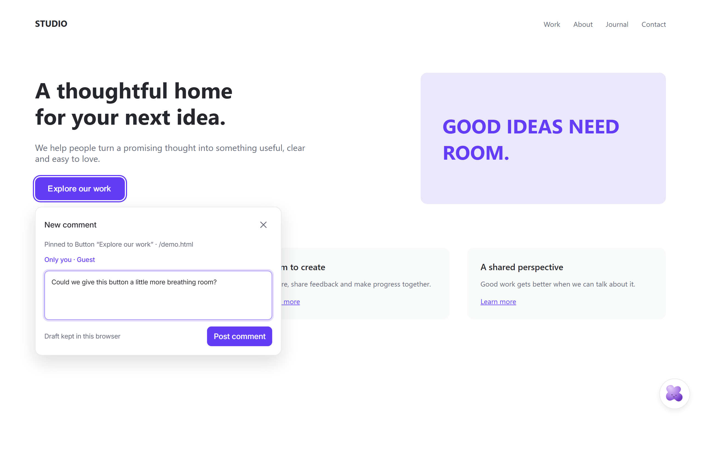
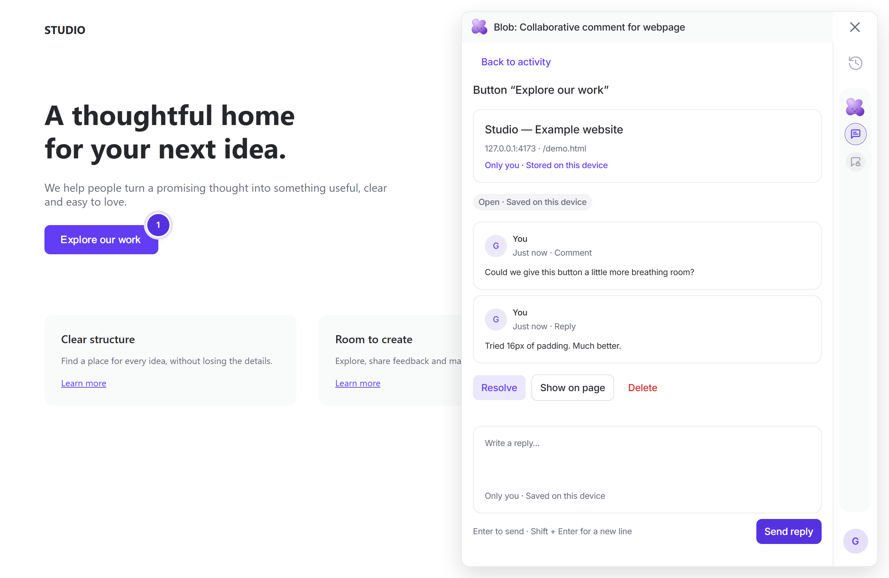
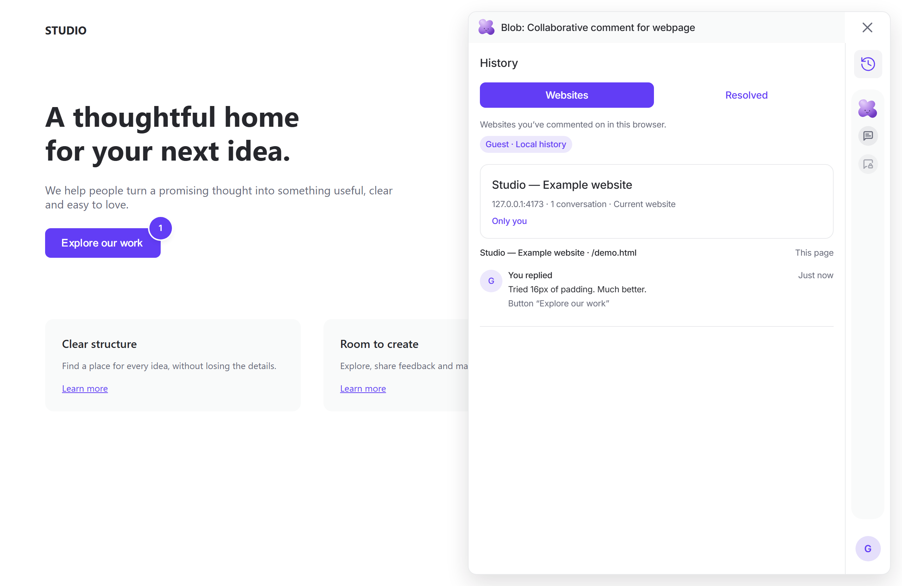

# Blob

Blob is an open-source Chrome extension for leaving persistent, Figma-style comments on parts of any website.

> **Status: local alpha.** You can pin a comment to an element on a real page, save it privately on your device, and find it again after a refresh. There are no accounts, sharing or rooms yet. See [docs/STATUS.md](docs/STATUS.md) for what has and has not been verified.



| Conversation | History |
| --- | --- |
|  |  |

## What works today

- A draggable Blob button on the page. Click to open the drawer, drag to move it.
- **Add a Blob**: choose any element, write a comment, and a numbered pin appears on it.
- Comments and replies are saved on your device and survive reloads and browser restarts.
- Resolve, reopen and delete conversations (delete asks first).
- **Activity** for the current website, with the current page kept separate from other pages.
- **History** grouped by website, then page, plus a Resolved view.
- Pins follow their element when the page scrolls or changes. If the element disappears, the conversation is kept, marked "Location unavailable", and can be reattached to a new element.
- Blob runs on a page only after you click its toolbar button, or on websites where you chose "Always show".

Not built yet: accounts, sharing, private rooms, real-time collaboration. See [docs/ROADMAP.md](docs/ROADMAP.md).

## Try it

You need [Node.js](https://nodejs.org) 22.18 or newer and Google Chrome.

```bash
npm install
npm run build
```

Then load it into Chrome:

1. Open `chrome://extensions`.
2. Turn on **Developer mode** (top right).
3. Click **Load unpacked** and choose the `.output/chrome-mv3` folder inside this project.
4. Pin Blob to the toolbar (puzzle-piece icon, then the pin next to Blob).
5. Open any ordinary website, click the Blob toolbar button, then **Use Blob on this page**.

No accounts, API keys or servers are needed.

## Commands

| Command | What it does |
| --- | --- |
| `npm run dev` | WXT's live-reloading development mode (not yet tried on this project). |
| `npm run build` | Production build into `.output/chrome-mv3`. |
| `npm run typecheck` | TypeScript check. |
| `npm test` | Unit tests (storage, page identity, anchoring, requests). |
| `npm run check:manifest` | Confirms the built extension asks only for the expected permissions. |
| `npm run check` | All four of the above, in order. |
| `npm run test:e2e` | Browser tests against the real built extension. Needs `npx playwright install chromium` once. |
| `npm run test:e2e:harness` | The same browser tests with stand-in extension APIs, for machines where the above cannot start. |
| `npm run screenshots` | Regenerates `docs/screenshots`. |
| `npm run zip` | Packages the build as a zip. |

## Privacy in one paragraph

Your comments stay in this browser, inside the extension's own storage. Nothing is sent anywhere. Blob does not read passwords, form fields or anything you type into a page, and it keeps no browsing history beyond the pages you commented on. Details: [docs/PRIVACY.md](docs/PRIVACY.md).

## Limitations

- Top-level HTML pages only. Not supported: content inside embedded frames, closed shadow roots, canvas-drawn apps, PDFs, local files, and browser pages such as `chrome://` or the Chrome Web Store.
- Comments are local. They are not backed up, and removing Blob or clearing its data deletes them.
- Without "Always show", Blob leaves when you reload or navigate, until you click the toolbar button again.

## Project layout

```
entrypoints/   background service worker, toolbar popup, and the on-page overlay entry
overlay/       the on-page UI (React, inside a Shadow Root)
lib/           storage, page identity, anchoring, messages, site access (no UI)
tests/         unit tests, browser tests and fixture pages
docs/          architecture, privacy, roadmap, status
```

More in [docs/ARCHITECTURE.md](docs/ARCHITECTURE.md).

## Contributing

See [CONTRIBUTING.md](CONTRIBUTING.md). Coding agents should read [AGENTS.md](AGENTS.md).

## Licence

[MIT](LICENSE). Bundled fonts and icons have their own licences: see [THIRD_PARTY.md](THIRD_PARTY.md).
